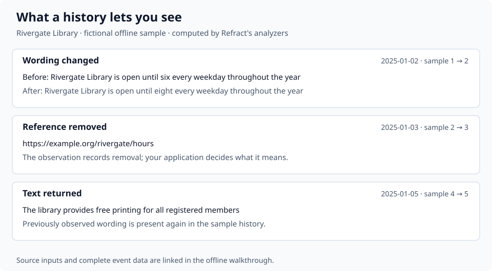

<div align="center">

# Refract

**Refract gives mutable knowledge a memory.**

See what changed in the sources you rely on since your last review, with text and revision links you can inspect.

[](https://github.com/refract-org/refract/actions/workflows/ci.yml)
[](https://github.com/refract-org/refract/releases)
[](./LICENSE)
[](https://bun.sh)
[](https://github.com/refract-org/refract/discussions)

</div>

## What does it do?

Refract compares revisions and produces events describing detected changes to wording, citations, and document structure. It provides temporal observability for knowledge: a history your tools can query alongside the current text.

Two observations captured from the Bitcoin article:

| Date | Before | After | Inspect the source |
|------|--------|-------|--------------------|
| 2010-03-18 | “The longest proof-of-work chain…” | “The longest proof-of-work block chain…” | [Prior revision](https://en.wikipedia.org/w/index.php?oldid=345930425), [next revision](https://en.wikipedia.org/w/index.php?oldid=350653695) |
| 2010-06-21 | A reference to the Bitcoin FAQ | Reference removed | [Prior revision](https://en.wikipedia.org/w/index.php?oldid=369361755), [next revision](https://en.wikipedia.org/w/index.php?oldid=369393212) |

The wording above is excerpted; the [captured events](./docs/examples/bitcoin-events.ndjson) contain the full matched text and removed reference. The observations describe these revision pairs. Their significance is for the reader or downstream application to assess.

[Reproduce the Bitcoin example](./docs/example-output.md) · [Inspect saved inputs](./docs/examples/bitcoin-revisions.json)

## Try an offline example

The bundled **fictional** Rivergate Library history demonstrates changed opening hours, a removed reference, and text that disappears and returns. The events are computed by the same analyzers used for wiki revisions.



[Read the captured walkthrough](./docs/examples/onboarding.txt) · [Download sample NDJSON](./docs/examples/sample-events.ndjson) · [Follow the offline recipe](./docs/recipes.md#try-the-offline-walkthrough)

To run the offline walkthrough from this checkout:

```bash
git clone https://github.com/refract-org/refract.git
cd refract
bun install --frozen-lockfile
bun run build
node packages/cli/dist/src/cli.js init
```

The new offline `init` and `init --json` behavior requires this source build until it is included in an npm release. You can inspect the captured artifacts above without installing anything.

## Review sources you already depend on

`refract review` keeps source changes pending until you acknowledge an inspected
report. It saves fetched revisions, resumes longer histories, and shows the
range it could observe. Each entry contains changed text and source context.

From the source build above, try the complete workflow offline:

```bash
node packages/cli/dist/src/cli.js review --sample --from 1 --state-dir ./review-state
```

Inspect the report, then use its printed acknowledgment command. Run it again
to see `no_changes`. The sample is fictional and makes no wiki requests. The new
review command requires this source build until it ships in an npm release.

For live sources, create a page-title watchlist and establish an inspected
baseline with `review --pages-file pages.txt`. Subsequent runs compare against
the last acknowledged revision. Your application decides which changes matter.

[Complete review workflow](./docs/review.md) · [Captured review](./docs/examples/review.md) · [Report JSON with saved inputs](./docs/examples/review.json)

## Quick start

For live Wikipedia analysis, install the CLI with Node.js 20+:

```bash
npm install -g @refract-org/cli
refract analyze "Bitcoin" --depth brief --json
```

This reads the latest 20 revisions on an uncached run and prints metadata as NDJSON. It requires network access. `brief` omits changed text; use `detailed` with a bounded revision range when you want wording:

```bash
refract analyze "Bitcoin" --from 345930425 --to 350653695 --depth detailed --json
```

For a browser timeline:

```bash
refract explore "Bitcoin" --from 345930425 --to 350653695
```

This fetches the specified pair, starts a local server at `localhost:8899`, and opens your browser. Keep the terminal running; Ctrl+C stops the server. Large histories can take longer to fetch and analyze.

Use a **page title**, such as `Bitcoin`, rather than a page URL. For another MediaWiki instance, pass its `api.php` endpoint with `--api`.

[Choose a history range and output mode](./docs/usage.md) · [Install compatibility](./COMPATIBILITY.md)

## Three workflows

| Your question | What you receive | Start here |
|---------------|------------------|------------|
| “What changed in my sources since my last review?” | Pending changes with full text, source links, coverage, and explicit acknowledgment | [Review a watchlist](./docs/review.md) |
| “What did the record say at an earlier date?” | A text preview and revision ID at or before the requested date | [Inspect an earlier record](./docs/recipes.md#inspect-an-earlier-record) |
| “My application needs changes as data.” | NDJSON events to filter, store, or pass to your review process | [Build a review feed](./docs/recipes.md#build-a-review-feed) |

Start with a small set of sources you already revisit. The [review guide](./docs/review.md#check-fit-with-a-real-review-process) provides a way to assess the workflow with your own review criteria. For a data integration, export events or consume the saved review report, select `citation_removed`, and inspect its source context.

## Core concepts

The central primitive is an **observed transition, anchored to source revisions**:

`available revision history → deterministic observations → queryable event history`

The same captured inputs, analyzer versions, and configuration produce the same event observations. Coverage is bounded by the analyzed history and matching rules; export timestamps can differ between runs.

Claim IDs describe text in page and section context. Matching rules associate wording across revisions. State labels and hashes have specific limits: see [claim-state timelines](./docs/concepts/claim-state-timelines.md) and [replay and verification](./ARCHITECTURE.md#replay-and-verification).

## What Refract captures

The event schema defines changes to:

| Part of the record | Examples |
|--------------------|----------|
| Sentences | First observed, modified, removed, reintroduced |
| Citations | Added, removed, replaced |
| Document structure | Section changes, lead/body changes, page moves |
| Links, categories, templates | Added, removed, template parameters changed |
| Revision activity | Revert patterns and edit clusters |
| Talk pages and access controls | Nearby talk-page activity and protection changes |

Events can carry deterministic enrichment fields such as change magnitude, extracted terms, and certainty-marker counts. [Event reference](./docs/events.md) explains the types and rules.

## Where it fits

The CLI fetches **MediaWiki revision histories**, including Wikipedia and compatible public or user-controlled wikis. Library consumers can supply versioned text through the common `Revision` model. An arbitrary web URL alone does not provide a revision history.

Refract derives observations under deterministic rules. Your application decides which changes matter and what to do with them. It does not establish that a statement is supported merely because it has a citation, or that editors disputed it merely because its wording changed.

[Repository boundary](./docs/repository-boundary.md) · [Architecture](./ARCHITECTURE.md) · [Refract and NextConsensus](./docs/refract-and-nextconsensus.md)

## Use it in your application

Choose the interface that matches your existing workflow:

| Interface | Use it when | Example |
|-----------|-------------|---------|
| CLI | You want to inspect or export a page's history | `refract export "Bitcoin" --from 369361755 --to 369393212 --format ndjson` |
| Libraries | You already fetch revisions or own versioned text inputs | `buildRevisionEvents(revisions, { depth: "detailed" })` |
| MCP | An agent needs to request histories and receive structured observations | `refract mcp` |
| Python | You work in Python and want events as dataclasses or DataFrames | `pip install "git+https://github.com/refract-org/refract.git#subdirectory=clients/python"` |

[Library adapter and data integrations](./docs/integrations.md) · [MCP setup](./docs/mcp.md) · [Private wiki access](./docs/usage.md#other-mediawiki-instances)

## Monorepo architecture

```
refract/
├── packages/
│   ├── evidence-graph/    # Types, schemas, identity & hash verification
│   ├── ingestion/         # MediaWiki client, pagination, retries & auth
│   ├── analyzers/         # Deterministic revision diffing & enrichment
│   ├── cli/               # CLI commands, output formatters & local browser
│   ├── mcp/               # Model Context Protocol server implementation
│   ├── persistence/       # SQLite local caching and revision store
│   └── eval/              # Evaluation harness & benchmark verification
├── apps/
│   ├── docs/              # Public documentation site (CC-BY-4.0)
│   └── ui/                # Browser-only file viewer
├── clients/
│   └── python/            # Python adapter over the CLI
├── docs/                  # Architecture specs, recipes & boundary definitions
│   └── examples/          # Captured revision inputs and engine output
└── demo-data/             # Local datasets
```

## Development and testing

```bash
git clone https://github.com/refract-org/refract.git
cd refract
bun install
bun run build
bun run test
bun run lint
```

The apps are workspaces with their own checks, run from their directories: `bun run lint`, `bun run test` and `bun run build` in `apps/docs` or `apps/ui`. The Python adapter uses Hatch and pytest in `clients/python`. CI runs them in `docs-site.yml`, `viewer.yml` and `python.yml`, separately from the engine gate.

## Packages

| Package | Role |
|---------|------|
| `@refract-org/evidence-graph` | Types, schemas, identity and verification primitives |
| `@refract-org/ingestion` | MediaWiki access, pagination, retries, and authentication |
| `@refract-org/analyzers` | Deterministic revision comparisons and enrichment |
| `@refract-org/cli` | Commands and the local browser explorer |
| `@refract-org/mcp` | MCP library; the executable is `refract mcp` from the CLI |
| `@refract-org/persistence` | Local SQLite persistence; not published |
| `@refract-org/eval` | Evaluation harness and independently sourced labels |

[Runnable examples](./examples/README.md) · [Benchmark corpus](./BENCHMARK.md)

## License

AGPL-3.0. See [LICENSE](./LICENSE).

If you modify this software and deploy it as a network service, you must release
your modifications.

**Commercial use:** NextConsensus offers commercial licenses for proprietary
integration without AGPL obligations. See [nextconsensus.com](https://nextconsensus.com).

## Community

- [Contributing](./CONTRIBUTING.md) — how to get started
- [Good first tasks](./ROADMAP.md) — ready-to-pick-up work items
- [Discussions](https://github.com/refract-org/refract/discussions) — questions, ideas
- [Code of Conduct](./.github/CODE_OF_CONDUCT.md)
- [Security](./.github/SECURITY.md)
- [Changelog](./CHANGELOG.md)
- [Cite this software](./CITATION.cff)

## Ecosystem

These build on the core engine:

| Project | Purpose |
|---------|---------|
| [Docs site](./apps/docs) | Public documentation site — [integrations](https://refract-org.github.io/refract/integrations/), quickstart, CLI, SDK, tutorials |
| [Viewer](./apps/ui) | Browser-only file viewer — load JSONL, render timelines, diffs, citations |
| [Demo data](./demo-data) | Local datasets; the [offline walkthrough](./docs/recipes.md#try-the-offline-walkthrough) uses a fictional library history |
| [Python adapter](./clients/python) | Calls the CLI and returns dataclasses or DataFrames |

The core owns event contracts, CLI behavior, and reproducible examples. The docs
site, the viewer and the Python adapter live in this repository with their own
licenses and CI workflows, and are checked against the engine's captured output.
See the [repository map](./docs/repositories.md) for ownership.

### Position in the revisable-delegation loop

Refract holds the **detect mismatch** step in the [STD-07 Revisable Delegation Record](https://ethotechnics.org/standards/std-07-revisable-delegation-record) loop, emitting structured `EvidenceEvent` records over source revisions. It identifies what changed without deciding whether a change matters: downstream consumers supply the predicate and the context.

- **Wired to**: [NextConsensus](https://nextconsensus.com) and [Ambit](https://github.com/zz-plant/ambit) via [`docs/refract-and-nextconsensus.md`](./docs/refract-and-nextconsensus.md) and [`docs/repository-boundary.md`](./docs/repository-boundary.md).
- **Siblings**: [Ambit](https://github.com/zz-plant/ambit) (capability and authorization), [Whether](https://github.com/zz-plant/whether) (act), [Ethotechnics](https://ethotechnics.org) (the record shape and vocabulary).

### Related projects

- [**Stims**](https://github.com/zz-plant/stims) — Browser music visualizer inspired by MilkDrop
- [**sabnzbd-mcp**](https://github.com/zz-plant/sabnzbd-mcp) — MCP server for SABnzbd (zero deps)
- [**neckass**](https://github.com/zz-plant/neckass) — Privacy-first headline generator
- [**ethotechnics.org**](https://github.com/zz-plant/ethotechnics.org) — Open framework for the operational accountability of high-stakes AI systems; publishes the record shape Refract's siblings share (see below)
