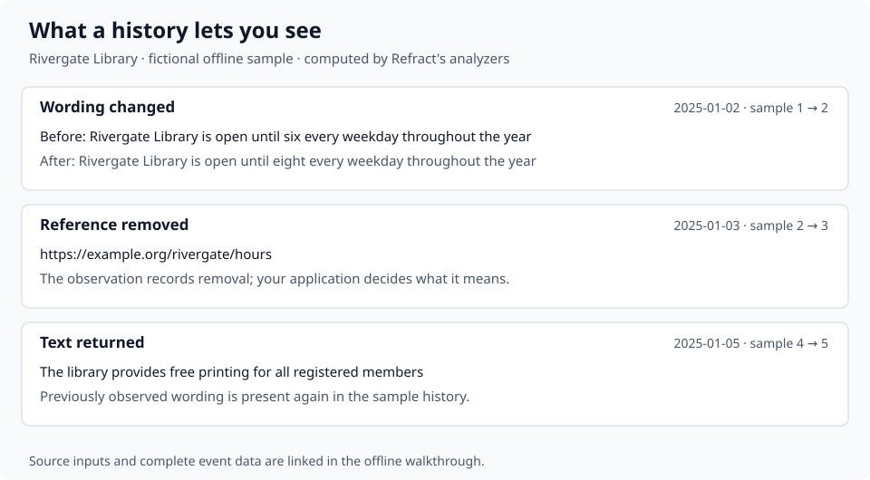

<div align="center">


# Refract

**`git log` for Wikipedia.**

See how a page's sentences, citations, and structure changed, revision by revision, as data you can check. Runs locally, with no API key or model.

[Documentation](https://refract-org.github.io/refract/) · [CLI reference](https://refract-org.github.io/refract/cli/) · [Compared to XTools and WikiBlame](https://refract-org.github.io/refract/compare/)

[](https://github.com/refract-org/refract/actions/workflows/ci.yml)
[](https://github.com/refract-org/refract/releases)
[](./LICENSE)

</div>

## Watch Pluto stop being a planet

On 24 August 2006, the International Astronomical Union reclassified Pluto as a dwarf planet. Wikipedia's Pluto article went through 43 revisions in under an hour that afternoon. Here is what Refract reports for its first sentence:

| UTC | First sentence | Source |
|-----|----------------|--------|
| 13:39 | Pluto **is** the ninth and smallest of the traditional planets of the Solar system, though its status as a planet has been disputed… | [revision](https://en.wikipedia.org/w/index.php?oldid=71593043) |
| 13:40 | Pluto **is** the ninth and smallest of the traditional planets of the Solar system, but on August 24, 2006 it was 'demoted'… | [diff](https://en.wikipedia.org/w/index.php?diff=71593165&oldid=71593043) |
| 13:41 | Pluto **was until recently considered** the ninth… | [diff](https://en.wikipedia.org/w/index.php?diff=71593296&oldid=71593165) |
| 13:59 | Pluto **is considered** the ninth and smallest of the traditional planets of the Solar system, except by the IAU… | [diff](https://en.wikipedia.org/w/index.php?diff=71595967&oldid=71595813) |
| 14:09 | Pluto **is widely considered** the ninth… | [diff](https://en.wikipedia.org/w/index.php?diff=71597482&oldid=71597389) |
| 14:10 | Pluto **was considered** the ninth… | [diff](https://en.wikipedia.org/w/index.php?diff=71597671&oldid=71597482) |
| 14:20 | Pluto **at one time was considered** the ninth… | [diff](https://en.wikipedia.org/w/index.php?diff=71599252&oldid=71599033) |
| 14:37 | Pluto **was considered** the ninth and smallest of the planets of the Solar system… | [diff](https://en.wikipedia.org/w/index.php?diff=71601937&oldid=71601076) |

Rows are excerpts and skip the edits between them. [Captured events](./docs/examples/pluto-events.ndjson) · [Walkthrough](./docs/example-output.md). Article text by Wikipedia contributors, [CC BY-SA](https://creativecommons.org/licenses/by-sa/4.0/).

Run one of these transitions yourself (Node.js 20+ and network access):

```bash
npx @refract-org/cli analyze Pluto --from 71593165 --to 71593296 --depth detailed --json
```

Each line is one event. The `sentence_modified` line holds the full `before` and `after` wording.

Refract reports what changed. Why it changed, and whether that matters, is for you to judge.

## Who it's for

- **Researchers and journalists** who need to show when a statement appeared, changed, or lost its citation.
- **Developers feeding wiki content to RAG pipelines or agents** who need change events alongside the current text.
- **Anyone who relies on a set of wiki pages** and wants to see what changed since they last checked.

Refract reads Wikipedia and any other MediaWiki wiki. It does not fetch arbitrary web pages; the libraries accept versioned text you supply. Events carry no editor identity, and the [misuse policy](./MISUSE_POLICY.md) rules out editor targeting.

## Questions it answers

| Your question | Command | What you receive | Start here |
|---------------|---------|------------------|------------|
| “When did this text appear, change, or disappear?” | `refract claim` | Candidate text, match kind, latest revision, and status within the fetched revisions | [Inspect changes to a passage](./docs/recipes.md#inspect-changes-to-a-passage) |
| “What did the page say at an earlier date?” | `refract snapshot` | A text preview and revision ID at or before the requested date | [Inspect an earlier record](./docs/recipes.md#inspect-an-earlier-record) |
| “My application needs changes as data.” | `refract export` | NDJSON events to filter, store, or pass to your review process | [Build a review feed](./docs/recipes.md#build-a-review-feed) |
| “What changed in my pages since my last review?” | `refract review` (source build) | Pending changes with full text, source links, coverage, and explicit acknowledgment | [Review a watchlist](./docs/review.md) |

## Install

```bash
npm install -g @refract-org/cli
refract analyze "Bitcoin" --depth detailed --json
```

This reads the page's latest 20 revisions. Use a **page title**, not a URL. For another wiki, pass its `api.php` endpoint with `--api`.

[Choose a history range and output mode](./docs/usage.md) · [Install compatibility](./COMPATIBILITY.md)

## Try it offline

The offline walkthrough and `refract review` are in this repository and will reach npm with the next release. Until then, run them from a source build:

```bash
git clone https://github.com/refract-org/refract.git
cd refract
bun install --frozen-lockfile
bun run build
node packages/cli/dist/src/cli.js init
```

`init` runs the analyzers on a bundled **fictional** library history and makes no network requests.



`review` keeps changes pending until you acknowledge an inspected report, then compares later runs against that point:

```bash
node packages/cli/dist/src/cli.js review --sample --from 1 --state-dir ./review-state
```

[Complete review workflow](./docs/review.md) · [Captured review](./docs/examples/review.md) · [Offline recipe](./docs/recipes.md#try-the-offline-walkthrough)

## What Refract captures

| Part of the record | Examples |
|--------------------|----------|
| Sentences | First observed, modified, removed, reintroduced |
| Citations | Added, removed, replaced |
| Document structure | Section changes, lead/body changes, page moves |
| Links, categories, templates | Added, removed, template parameters changed |
| Revision activity | Revert patterns and edit clusters |
| Talk pages and access controls | Nearby talk-page activity and protection changes |

Events can carry deterministic enrichment fields such as change magnitude, extracted terms, and certainty-marker counts. [Event reference](./docs/events.md)

## How it works

Refract compares revisions under deterministic rules and makes no model calls. The same captured inputs, analyzer versions, and configuration produce the same events; export timestamps can differ. Coverage is limited to the analyzed revisions and the matching rules.

A citation does not establish that a statement is supported, and changed wording does not establish that editors disputed it. Your application decides what the events mean.

[Architecture](./ARCHITECTURE.md) · [Claim-state timelines](./docs/concepts/claim-state-timelines.md) · [Repository boundary](./docs/repository-boundary.md) · [Share or check a result](./docs/recipes.md#share-or-check-what-you-found)

## Use it in your application

| Interface | Use it when | Example |
|-----------|-------------|---------|
| CLI | You want to inspect or export a page's history | `refract export "Bitcoin" --from 369361755 --to 369393212 --format ndjson` |
| Libraries | You already fetch revisions or own versioned text inputs | `buildRevisionEvents(revisions, { depth: "detailed" })` |
| MCP | An agent needs to request histories and receive structured observations | `refract mcp` |
| Python | You work in Python and want events as dataclasses, DataFrames, or LangChain documents | `pip install "git+https://github.com/refract-org/refract.git#subdirectory=clients/python"` |
| Agent skill | Your coding agent should know which command answers which question | `cp -R skills/refract ~/.claude/skills/` |
| Viewer | You want to browse an exported file in a browser | [`apps/ui`](./apps/ui) |

[Library adapter and data integrations](./docs/integrations.md) · [MCP setup](./docs/mcp.md) · [Agent skill](./skills/refract/SKILL.md) · [Private wiki access](./docs/usage.md#other-mediawiki-instances)

## Development and testing

```bash
git clone https://github.com/refract-org/refract.git
cd refract
bun install
bun run build
bun run test
bun run lint
```

The apps are workspaces with their own checks, run from their directories: `bun run lint`, `bun run test` and `bun run build` in `apps/docs` or `apps/ui`. The Python adapter uses Hatch and pytest in `clients/python`. CI runs them in `docs-site.yml`, `viewer.yml` and `python.yml`, separately from the engine gate.

| Package | Role |
|---------|------|
| `@refract-org/evidence-graph` | Types, schemas, identity and verification primitives |
| `@refract-org/ingestion` | MediaWiki access, pagination, retries, and authentication |
| `@refract-org/analyzers` | Deterministic revision comparisons and enrichment |
| `@refract-org/cli` | Commands and the local browser explorer |
| `@refract-org/mcp` | MCP library; the executable is `refract mcp` from the CLI |
| `@refract-org/persistence` | Local SQLite persistence; not published |
| `@refract-org/eval` | Evaluation harness and independently sourced labels |

[Runnable examples](./examples/README.md) · [Benchmark corpus](./BENCHMARK.md) · [Repository map and related projects](./docs/repositories.md)

## License

AGPL-3.0. See [LICENSE](./LICENSE).

If you modify this software and deploy it as a network service, you must release
your modifications.

**Commercial use:** NextConsensus offers commercial licenses for proprietary
integration without AGPL obligations. See [nextconsensus.com](https://nextconsensus.com).

## Community

- [Contributing](./CONTRIBUTING.md) — how to get started
- [Roadmap](./ROADMAP.md) — what is being worked on
- [Discussions](https://github.com/refract-org/refract/discussions) — questions, ideas
- [Code of Conduct](./.github/CODE_OF_CONDUCT.md)
- [Security](./.github/SECURITY.md)
- [Changelog](./CHANGELOG.md)
- [Cite this software](./CITATION.cff)
